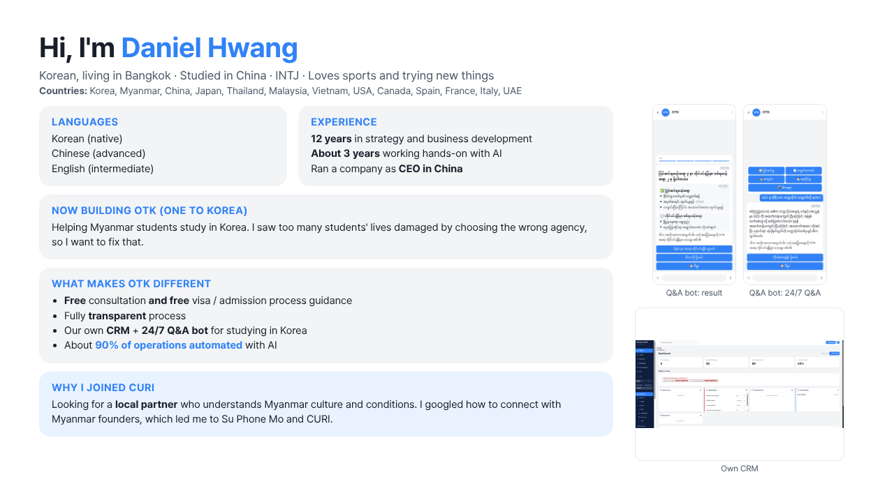
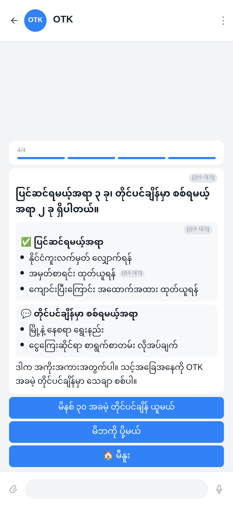
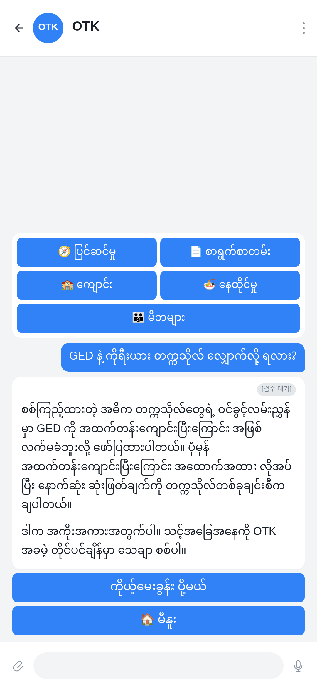

<!-- ============================================================= -->
<!--  Daniel Hwang · GitHub Profile README                         -->
<!-- ============================================================= -->

<h1 align="center">👋 Hi, I'm Daniel Hwang</h1>

  <b>Founder</b> &nbsp;·&nbsp; <b>Strategy & BD</b> &nbsp;·&nbsp; <b>AI-operated businesses</b>

  Korean 🇰🇷 living in <b>Bangkok</b> 🇹🇭 &nbsp;·&nbsp; Studied in China 🇨🇳 &nbsp;·&nbsp; INTJ 
  Loves sports 🏋️ and trying new things

  
  
  

  

---

### 🧑‍💼 About Me

- 🧠 **12 years** in strategy & business development · ~**3 years** hands-on with AI
- 🏢 Ran a company as **CEO in China**; also operated in the **USA**
- 🌏 Across Korea, Myanmar, China, Japan, Thailand, Malaysia, Vietnam, USA, Canada, Spain, France, Italy, UAE
- 🗣️ **Korean** (native) · **Chinese** (advanced) · **English** (intermediate)
- 🏌️ Also building in **golf**, **fashion**, and **coffee** — OTK is one of my business projects

---

### 🚀 What I'm Building Now

#### One to Korea (OTK) — *one of my projects*
Helping Myanmar students study in Korea. I saw too many lives damaged by the wrong agency — so I'm fixing the path with **free**, **transparent**, **AI-operated** ops.

- 🎓 Free consultation + free visa / admission process guidance
- 🔍 Fully transparent process (student & parents stay informed)
- 🤖 Own **CRM** + **24/7 Q&A bot** (Telegram) for Korea study questions
- ⚙️ ~**90%** of operations automated with AI agents
- 🤝 Looking for a Myanmar partner who gets local culture & ops (via CURI / Su Phone Mo)

  
  &nbsp;
  

#### Other industries I work in
- ⛳ **Golf** — China golf / elite segment projects
- 👗 **Fashion** — fashion ERP & related ops
- ☕ **Coffee** — Korean café roaster / China manufacturing exploration

---

### 🧰 Tools I Use

**AI & agents**

**Build & infra**

**Ops & content**

---

### 📌 Featured

| Project | What it is |
|--------|------------|
| [`mingalar-edu`](https://github.com/young0100/mingalar-edu) | Education / Myanmar stack |
| [`otk-media`](https://github.com/young0100/otk-media) | OTK public media assets |
| `otkme_crm_final` | Student CRM (private) — leads, docs, messenger |

---

  <i>Build trust first. Automate the rest.</i>

